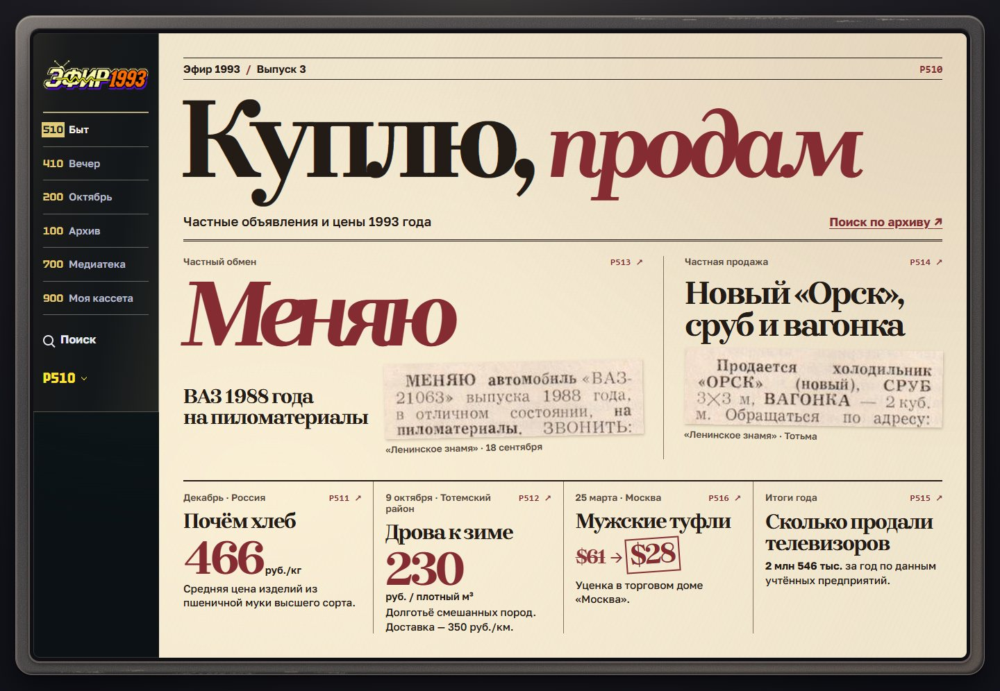

# ЭФИР 1993

Русскоязычный сайт о России 1993 года. Его можно читать выпусками или открыть отдельную запись по трёхзначному номеру, как страницу телетекста. Архив объединяет 22 истории с указанием источников. Среди них — семейная фотография Дома Советов, сентябрьская телепрограмма, объявление об обмене автомобиля и таблица продаж телевизоров.

**[Открыть сайт в Sites](https://efir-1993.gubarevf.chatgpt.site)** · [Скачать автономный HTML](https://github.com/Vasilisk101/efir1993/raw/refs/heads/main/downloads/efir-1993.html) · [Руководство читателя](docs/GUIDE.md) · [Каталог первоисточников](docs/SOURCES.md)



## Выпуск «Куплю, продам»

Что можно узнать о покупке по объявлению, газетному обзору или государственной статистике? На обложке P510 собраны шесть материалов. Четыре строки в районной газете сообщают, что владелец хотел получить за ВАЗ. Таблица Госкомстата позволяет узнать, сколько телевизоров за год продали предприятия, вошедшие в отчётность.

| Страница | Материал |
| --- | --- |
| [P511](https://efir-1993.gubarevf.chatgpt.site/#511) | Декабрьские средние цены на хлеб и сахар, рубли за килограмм |
| [P512](https://efir-1993.gubarevf.chatgpt.site/#512) | Дрова с Пятовского нижнего склада. Цены за плотный кубометр и отдельная плата за доставку |
| [P513](https://efir-1993.gubarevf.chatgpt.site/#513) | ВАЗ-21063 1988 года выпуска в обмен на пиломатериалы |
| [P514](https://efir-1993.gubarevf.chatgpt.site/#514) | Новый холодильник «Орск», сруб и два кубометра вагонки в одном объявлении |
| [P515](https://efir-1993.gubarevf.chatgpt.site/#515) | Годовые продажи телевизоров и магнитофонов у официально учтённых предприятий |
| [P516](https://efir-1993.gubarevf.chatgpt.site/#516) | Мартовская уценка мужских туфель в торговом доме «Москва», с 61 до 28 долларов |

## Другие разделы

| Страница | Что открыть |
| --- | --- |
| [P100 · Архив](https://efir-1993.gubarevf.chatgpt.site/#100) | Общий указатель с поиском и фильтром по виду материала |
| [P200 · Октябрь](https://efir-1993.gubarevf.chatgpt.site/#200) | Фотография Москвы, цены на автозапчасти и тульская театральная хроника |
| [P410 · Свободный вечер](https://efir-1993.gubarevf.chatgpt.site/#410) | Телепрограмма, игры Dendy, мультфильм и головоломка из «Кванта» |
| [P700 · Медиатека](https://efir-1993.gubarevf.chatgpt.site/#700) | Фотографии, видео и сканы с переходом к записи, где объяснён источник |
| [P900 · Моя кассета](https://efir-1993.gubarevf.chatgpt.site/#900) | Личные закладки в этом браузере |

## Запуск на своём компьютере

Из корня репозитория выполните команду с Python 3.

```sh
python -m http.server 8000 --directory dist
```

Откройте [localhost:8000](http://localhost:8000/). Номер после решётки ведёт к конкретной записи, например [localhost:8000/#513](http://localhost:8000/#513). Для остановки сервера нажмите `Ctrl+C` в терминале.

Из тех же материалов можно собрать один HTML-файл.

```sh
python tools/standalone.py output.html
```

В файле можно читать записи и смотреть вложенные изображения. Сайты держателей источников и видеопоток требуют интернета. Если размещённая версия в Sites доступна только участникам выбранной аудитории, локальная копия запускается описанным выше способом.

## Устройство репозитория

| Путь | Назначение |
| --- | --- |
| [dist/index.html](dist/index.html) | Стартовая страница |
| [dist/archive.js](dist/archive.js) | Записи архива в `window.EFIR_RECORDS` |
| [dist/app.js](dist/app.js) | Переходы по номерам, поиск, кассета и прежние выпуски |
| [dist/daily.js](dist/daily.js) | Выпуск «Куплю, продам» и медиатека |
| [dist/screen.css](dist/screen.css), [dist/daily.css](dist/daily.css) | Оформление экрана и нового выпуска |
| [dist/assets/](dist/assets/) | Изображения, фрагменты документов и шрифты |
| [tools/check.py](tools/check.py), [tools/standalone.py](tools/standalone.py) | Проверка сайта и сборка одного HTML-файла |
| [history/](history/) | Три ранних прототипа |

[Концепция и работа с источниками](docs/CONCEPT.md) · [История проекта](CHANGELOG.md) · [Устройство и функции](docs/DEVELOPMENT.md)


Локальные изображения, ссылки на правообладателей, авторство и лицензии описаны в [источниках](docs/SOURCES.md). Обложка третьего выпуска находится в `dist/daily.js`, медиатека и дополнения к карточкам — в `dist/media.js` и `dist/library.css`.
